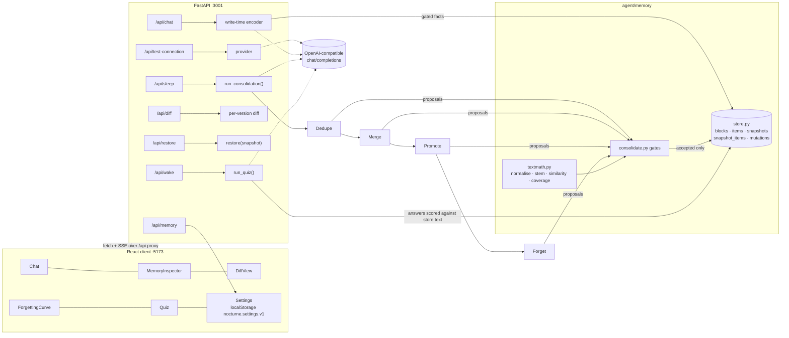

# Nocturne

A chat agent that **consolidates its own memory while it sleeps**.

Chat for a few turns — signal and noise mixed — hit **Sleep**, and four passes run over the
agent's memory blocks: **Dedupe → Merge → Promote → Forget**. Every proposal the model makes is
checked by code before it is allowed to touch the store, every refusal is reported with the reason,
a snapshot is written before and after each pass, and a **Wake** quiz then proves that recall still
works on what survived — and that what was deliberately forgotten is genuinely gone.

The claim being tested: agent memory is usually either append-only bloat or lossy summarisation.
*Deliberate, auditable forgetting under a stated retention policy* is the missing piece, and the
part that needs proving is that forgetting stayed safe: nothing invented, nothing un-said that
should have survived, and every mutation reversible.

---

## Which memory backend actually ran

**SQLite fallback — `LETTA_MODE=sqlite`.** The Letta block model was implemented over SQLite
behind the required interface (`list_blocks / get_block / append / replace / snapshot / restore`),
in `agent/memory/store.py`.

Why not the Letta server: `pip install letta` in this build environment resolves to **letta 0.34.1,
which is "Letta Code"** — a CLI for Letta's hosted agents. It no longer ships a self-hosted
memory-block REST server, `letta server --listen` only opens a local app-server WebSocket
(`ws://127.0.0.1:50713`) that needs a cloud login, and the Docker daemon is not running here, so
nothing could be brought up on **:8283**. `letta-client 1.12.1` *is* installed, so the Letta path is
reachable the moment a real server answers on `LETTA_BASE_URL` — set `LETTA_MODE=letta` in `.env`
and the same blocks are driven through Letta's API instead of SQLite; the consolidation, diff,
restore and quiz code does not change, because it only ever talks to the six-method store interface.

Blocks used: `persona`, `human`, `episodes`, `scratch`.

**Inference backend that ran:** the local **LM Studio** server
(`http://localhost:1234/v1`, `google/gemma-4-e4b`). No Particle.ai key was present in this
environment, so `.env.example`'s documented default (`https://api.particle.ai/v1`,
`deepseek-v4.1-flash`) could not be used — it answers `401`. Paste a real `pa-…` key into `.env`
(or the Settings panel) and everything runs against Particle.ai unchanged; nothing in the code is
provider-specific.

---

## Stack

| piece | where |
| --- | --- |
| Client | Vite + React 18 + TypeScript + Tailwind, **:5173**, `/api` proxied to :3001 |
| Server | Python 3.11+/3.12 + FastAPI, **:3001** |
| Memory | SQLite (`nocturne.db`), Letta-compatible interface |
| LLM | plain `fetch`-style `POST {baseUrl}/chat/completions`, `response_format={"type":"json_object"}` |

```
agent/main.py                   FastAPI: /api/chat /api/sleep /api/wake /api/memory /api/diff /api/restore
                                (+ /api/health /api/test-connection /api/reset /api/mutations)
agent/memory/store.py           block store + versioning (SQLite)
agent/memory/consolidate.py     the four passes + the write-time encoder
agent/memory/textmath.py        normalisation, token sets, coverage, proper nouns (the gate vocabulary)
agent/recall.py                 the wake quiz
agent/inference.py              provider presets + plain completion calls
agent/verify.py                 `python -m agent.verify`
client/src/components/          Chat MemoryInspector DiffView ForgettingCurve Quiz Settings
```

## Technologies

Exact versions as installed and verified in this build (`.venv/bin/python` = CPython 3.12.11,
Node 26, npm 11 on an Apple-silicon Mac).

| layer | choice | version | what it does here |
| --- | --- | --- | --- |
| Client | React / React DOM | 18.3.1 | the six panels; no router, one screen |
| Client | Vite | 5.4.21 | dev server on :5173 + `/api` proxy to :3001 |
| Client | TypeScript | 5.9.3 | `strict`, `noUnusedLocals`, `noEmit` typecheck in `npm run build` |
| Styling | Tailwind CSS | 3.4.19 | dark theme via semantic tokens in `tailwind.config.js` |
| Charts | hand-rolled SVG | — | the forgetting curve has no chart dependency |
| Server | FastAPI | 0.142.2 | REST + `text/event-stream` responses |
| Server | Uvicorn | 0.54.0 | ASGI server on :3001 |
| HTTP | httpx | 0.28.1 | every LLM call; plain `POST {baseUrl}/chat/completions` |
| Validation | pydantic | 2.13.5 | FastAPI's request/response model layer (bodies are read as dicts) |
| Config | python-dotenv | — | loads `.env` once at import |
| Storage | SQLite (WAL) | stdlib `sqlite3` | blocks, items, snapshots, mutations, transcript |
| Memory API | `letta-client` | 1.12.1 | installed for `LETTA_MODE=letta`; this run used the SQLite fallback |

No ORM, no SDK, no embeddings, no vector store, no auth, no queue. Deliberately: the interesting
part is the guardrail logic, and every line of it should be readable.

## Architecture



Two rules hold the design together:

1. **The model proposes, the code applies.** Nothing reaches the store except through a gate in
   `consolidate.py`, and the gate re-derives its decision from the data rather than trusting the
   model's claim.
2. **One store interface.** Chat, consolidation, quiz, diff and restore all speak the same six
   methods (`list_blocks / get_block / append / replace / snapshot / restore`), so SQLite and Letta
   are interchangeable underneath.

### What one Sleep does to the version line

```
 before          dedupe             merge            promote             forget
   │                │                 │                 │                  │
   ▼                ▼                 ▼                 ▼                  ▼
 #10 ─────────► #11 ──────► #12 ──────────► #13 ────► #15 ──────► #17 ───► #19
 start          before        after        before      after       before    after
 8 facts        8 facts       7 facts      7 facts     7 facts     7 facts   6 facts
                └ drop m_6    └ REJECT     └ promote   └ forget m_8
                  (sim 1.00)    merge ×1     ×5           (stale 70d)
```

Every arrow is a full immutable copy of the active set in `snapshot_items`, which is why the Diff
panel can compare *any* two versions and why "restore" is a forward-moving action rather than a
destructive one — the restore itself becomes version #20.

### The SSE transport, both ends

`/api/sleep` and `/api/wake` stream progress because a consolidation runs for minutes. `EventSource`
cannot POST a body, so the client reads the stream itself:

```ts
// client/src/lib/api.ts
export async function postSse(url, body, onEvent, signal) {
  const res = await fetch(url, { method: "POST", body: JSON.stringify(body), signal });
  const reader = res.body.getReader();
  const decoder = new TextDecoder();
  let buffer = "";
  for (;;) {
    const { value, done } = await reader.read();
    if (done) break;
    buffer += decoder.decode(value, { stream: true });
    let cut;
    while ((cut = buffer.indexOf("\n\n")) >= 0) { /* split frames, parse event:/data: */ }
  }
}
```

```python
# agent/main.py — a worker thread does the slow work; the generator only relays events
events: queue.Queue[dict] = queue.Queue()
threading.Thread(target=worker, daemon=True).start()
...
item = events.get(timeout=15.0)          # a pass can be silent for minutes
yield ": keepalive\n\n"                  # ... so send a comment to keep the proxy awake
```

## Run it

```bash
python3.12 -m venv .venv && .venv/bin/pip install -r requirements.txt   # or: uv venv --python 3.12 .venv && uv pip install -r requirements.txt
cp .env.example .env            # then set OPENAI_API_KEY / MODEL
cd client && npm install && cd ..
npm run dev                     # backend :3001 + client :5173
open http://localhost:5173
```

`npm run verify` runs `python -m agent.verify` (the wrapper prefers `.venv/bin/python` when present).

Then: chat a few turns (include a repeated fact, a restatement, something dated, something you want
kept), press **Sleep**, watch the four passes, inspect the diff, press **Wake**.

---

## The four passes

Every pass is one LLM call with strict JSON output, followed by **code-side verification**. The
model may propose; only the code may apply. Verbatim in every pass prompt:

> *"You may only reference itemIds that appear in the input. You may not invent facts, names,
> numbers or dates. If you are unsure, omit the item from all lists."*

Each pass logs input count, proposals, acceptances, rejections, and takes a snapshot before and
after (`data`/snapshots are visible in the UI as `pass:<name>:before|after`).

| pass | model returns | gate applied by code | rejection looks like |
| --- | --- | --- | --- |
| **1 Dedupe** | `{"drop":[{"itemId","duplicateOf","reason"}]}` | both ids exist in the pre-pass store and are active; `itemId != duplicateOf`; `duplicateOf` not itself dropped; normalised token-set **containment ≥ 0.9**; reason non-empty | `normalised token-set similarity 0.86 < 0.90; not semantically identical` |
| **2 Merge** | `{"merge":[{"intoId","fromIds":[…],"mergedText","reason"}]}` | every id exists, active, unconsumed, single block; **every non-stopword token of `mergedText` occurs in ≥ 1 source** (coverage == 1.0); **no new proper nouns**; reason non-empty | `mergedText is not traceable to its sources: 2 content token(s) appear in none of them (kubernetes, gcp)` |
| **3 Promote** | `{"promote":[{"itemId","toBlock","reason"}]}` | `toBlock ∈ {persona, human, episodes}`; item active and not already there; reason non-empty; **identity/preference/commitment facts are applied first** (`priority: protected`) | `toBlock 'longterm' is not one of ('persona', 'human', 'episodes')` |
| **4 Forget** | `{"forget":[{"itemId","reason","policy"}]}` | item active; **category not protected**; and it qualifies under a rule: `ageDays > STALE_AFTER_DAYS` (**stale**) *or* `itemId ∈ overflowIds` (**capacity**); the code records the rule it verified, not the rule the model claimed | `category 'commitments' is protected by the retention policy (identity, preferences, commitments)` |

Dedupe is *adjudication of engine-flagged candidates*: the code computes `candidatePairs` with its
own normalised comparison and the model decides each one, so a duplicate the model failed to notice
is still surfaced for a decision. Rejections are never silently dropped — they appear in the Diff
panel under **Rejected mutations** and in the per-pass counts.

### The gate, in code

The single sentence every pass prompt ends with, kept as a constant so no prompt can drift from it:

```python
# agent/memory/consolidate.py
GUARDRAIL = (
    "You may only reference itemIds that appear in the input. You may not invent facts, "
    "names, numbers or dates. If you are unsure, omit the item from all lists."
)
```

Merge is where invention would bite hardest, so the gate measures the rewrite against its own
sources before anything is written:

```python
sources_text = [s["text"] for s in sources]
cov, missing_tokens = tm.coverage(merged_text, sources_text)
if cov < 1.0:
    reject(raw, f"mergedText is not traceable to its sources: {len(missing_tokens)} content token(s) "
                f"appear in none of them ({', '.join(missing_tokens[:8])})")
    continue
new_names = tm.proper_nouns(merged_text) - {n for s in sources for n in tm.proper_nouns(s["text"])}
if new_names:
    reject(raw, f"mergedText introduces proper nouns absent from every source: {sorted(new_names)}")
    continue
```

Forget never asks the model whether a fact *should* go; it asks which facts *may* go, and then
checks that the one it picked is actually eligible — and records the policy it verified, not the
policy the model claimed:

```python
qualifies_stale = item["ageDays"] > policy.stale_after_days
qualifies_capacity = item_id in overflow
if not qualifies_stale and not qualifies_capacity:
    reject(raw, f"item is {item['ageDays']:.1f}d old (staleAfterDays={policy.stale_after_days:g}) and not "
                f"over capacity, so no retention rule authorises forgetting it")
    continue
verified_policy = "stale" if qualifies_stale else "capacity"
```

Both gates rest on four tiny functions, which makes the whole rule set auditable in one screen:

```python
# agent/memory/textmath.py
def similarity(a, b):                       # token-set containment over folded tokens
    ta, tb = token_set(a), token_set(b)
    if not ta or not tb:
        return 1.0 if normalize(a) == normalize(b) else 0.0
    return len(ta & tb) / min(len(ta), len(tb))

def coverage(claim, sources):               # how much of the claim exists in the sources
    claim_norm = " ".join(stem_token(t) for t in normalize(claim).split())
    ...
    missing = sorted({t for t in content if t not in vocab})
    return (len(content) - len(missing)) / len(content), missing
```

The store's versioning is equally small. A snapshot is a full copy of the active set, and a restore
is a delete-and-reinsert followed by *another* snapshot, so the undo is itself undoable:

```python
# agent/memory/store.py
def restore(self, snapshot_id: str) -> dict[str, Any]:
    rows = self._conn.execute("SELECT * FROM snapshot_items WHERE snapshot_id=?", (snapshot_id,)).fetchall()
    self._conn.execute("DELETE FROM items")
    self._conn.executemany("INSERT INTO items(...) VALUES(...)", [...rows...])
    new_id = self.snapshot(f"restore:{snapshot_id}")     # the restore is versioned too
    return {"restoredFrom": snapshot_id, "snapshotId": new_id, "activeCount": ...}
```

### What "similar" and "traceable" mean here


`agent/memory/textmath.py`, shared by every gate:

- **normalise** — NFKC, lowercase, apostrophes folded away, punctuation → spaces, whitespace collapsed.
- **stem fold** — possessive stripped, then a trailing plural `-s` unless the word ends in `-ss`/`-us`
  or is ≤ 3 characters. Not a real stemmer; deliberately bounded so a rejection can be explained in
  one sentence.
- **similarity(a, b)** = `|A ∩ B| / min(|A|, |B|)` over folded, stopword-free token *sets*
  (containment, not Jaccard: a strict restatement-with-extra-words is still the same fact).
  Gate threshold: **0.9**.
- **coverage(claim, sources)** = fraction of the claim's folded non-stopword content tokens present in
  the source vocabulary (stopwords stay in the source vocabulary, since a rewrite may promote a
  function word into content). Merge requires exactly **1.0**.
- **proper_nouns(text)** — capitalised-initial words not at a sentence start; the merge and encoder
  gates refuse any name not spelled in the sources.

### Write-time encoder

Before consolidation, each chat turn is encoded into atomic facts in `scratch` by an LLM call with
the same guardrail, and each fact is gated the same way: **fully traceable to the transcript, no new
proper nouns, ≥ 2 content tokens**. Facts are *not* de-duplicated at write time — append-only bloat is
the exact condition the Dedupe pass exists to fix. Refused facts are reported in the chat pane.

### Retention policy

```
MAX_ACTIVE_FACTS=120        STALE_AFTER_DAYS=45        PROTECTED_CATEGORIES=identity,preferences,commitments
```

- The Forget pass may only remove a fact that is stale *or* past capacity *and* unprotected.
- Capacity is computed deterministically. Salience = block weight (`persona 60, human 50,
  episodes 30, scratch 10`) + `40` if the category is protected + a recency term that decays to zero
  at `STALE_AFTER_DAYS`; the ranking is tie-broken by age then itemId, and everything past the cap is
  `overflowIds`.
- If the model under-proposes, three **deterministic backstops** apply the engine's own stated rules
  rather than trusting the proposal list: leftover `>= 0.9` duplicate pairs are dropped
  (`enforcedBy: engine-duplicate-rule`), durable-category facts left in `scratch` move to the block
  the policy names (`engine-promotion-rule`: identity/preferences/commitments → `human`, events →
  `episodes`), and the fact cap is enforced (`policy-engine`). All three are labelled separately in
  the UI and in the mutation log, so model-proposed and engine-enforced mutations are never
  conflated — and a rule the model can simply forget to apply would not be a rule.
  Nothing here invents: each backstop only moves or retires text that is already in the store.
- Protected categories are never forgotten, even when stale, even when over capacity — so a tight cap
  bottoms out at the number of protected facts, which `verify` reports explicitly.

Nothing is hard-deleted. `active = 0` in the live view, rows stay in `nocturne.db` forever, every
version is captured in `snapshot_items`, `restore(snapshotId)` rewinds the live view and records
itself as a new version (undo of undo stays possible).

---

## Wake: the recall quiz

`agent/recall.py`, after consolidation:

1. Candidates are chosen deterministically (promoted and protected facts first).
2. The model phrases one question per candidate; the code **refuses any question that leaks ≥ 50 %
   of the answer's own content words**, and records why.
3. Each question is answered with the consolidated blocks in context and the instruction to reply
   with the complete memory statement.
4. **The expected answer is the store's text.** Scoring compares the reply against the store:
   coverage of the fact's content tokens ≥ 0.9. The model's own opinion is not the answer key.
5. One question targets a fact the Forget pass removed. It passes only if **all three** hold: the
   fact has no ≥ 0.9 match anywhere in the active store (`absentFromStore`), the agent says it is
   not in memory (`saidAbsent`), and the reply does not leak the forgotten content.
6. Results are written to `recall-report.json` (questions, store-expected answers, model answers,
   coverage, missing tokens, leak scores, rejections, verdict).

---

## UI

Dark Tailwind. Left: streamed chat (thinking / streaming / error states, plus a "memory written"
note showing which facts passed the encoder and which were refused). Right: tabbed panels.

- **Sleep** — per-pass cards with live counts (in / proposed / accepted / rejected / policy-enforced),
  active-fact bar, snapshot ids, per-pass errors with the provider's real status and body.
- **Memory** — blocks with counts, click to expand, category chips, staleness badges
  (`stale` past the threshold, `aging` past half of it), protected marker.
- **Diff** — any two versions, three columns (**Kept / Changed / Forgotten**, plus Added), colour
  coded, a reason tooltip per row, merge rows show their source texts and the pre-merge text,
  a **Rejected mutations** list, and **restore "snapshot"** as an action.
- **Forgetting curve** — active-fact count per stored version, with the `MAX_ACTIVE_FACTS` line drawn.
- **Wake** — pass/fail per question with the store-derived expected answer, coverage, missing tokens,
  and the forgotten-fact probe with its three checks.
- **Settings** — provider presets (Particle.ai default, LM Studio, Ollama, Gemini, Custom), base URL /
  key / model, retention policy, **dry run** toggle, Test connection (real status + body per step),
  wipe. Persisted to `localStorage` under `nocturne.settings.v1`. The API key is only ever sent
  *with* a request; the server redacts it from any provider body it echoes back and never returns it.
- **Dry-run banner** — Sleep computes the whole plan and its rejections and writes nothing to the
  active view.

---

## Verification

`npm run verify` → `python -m agent.verify`. It seeds a scripted 8-turn conversation through the
*real* chat path (assistant replies generated by the model) and the *real* encoder, runs a dry run
then a real consolidation, and asserts, in order:

0. **guardrail self-test (no model, no network)** — 14 adversarial and legal proposals are pushed
   straight through the four gates, plus the capacity and promotion backstops: ghost itemIds,
   self-pairs, dissimilar "duplicates", merged text with an invented word, merged text that
   TitleCases a name out of nowhere, illegal `toBlock`s, a stale *commitment*, an ineligible
   forgetting, and the legal counterpart of each. Every refusal must carry the right reason.
1. fixture shape — 2 verbatim duplicates, 3 restatements, 2 items older than the policy, 1 protected
   commitment, 4 durable facts (all measured from the store, not assumed);
2. dry run changes nothing but produces a non-trivial plan;
3. duplicates collapsed, stale items forgotten, protected item kept, durable facts promoted;
4. every accepted mutation has a reason **and re-passes its own gate when re-audited from the DB**
   (drop pairs re-measured, merge texts re-checked for coverage and new proper nouns, promote targets
   re-checked against the whitelist, forgets re-checked against the rules), and every rejected
   mutation carries a rejection reason;
5. **global no-invention audit**: every surviving active fact must be 100 % traceable to the raw
   transcript and introduce no name absent from it;
6. wake quiz 5/5 against the store + forgotten fact absent and reported unknown;
7. the same seeded facts consolidated twice with different `MAX_ACTIVE_FACTS` on separate database
   clones gives a measurably different forget count.

Two honest notes about the fixture. (a) The spec's "near-duplicate" is measured as *flagged by the
engine but different wording* — with a containment metric, a one-word swap inside an 8-token fact
scores 0.86 and is correctly **refused** by the ≥ 0.9 gate, so those short rewordings stay in the
store and show up as rejections, while true restatements (subsets) are collapsed. (b) If the model's
extraction leaves the store short of the shape the spec asks for, `verify` appends duplicates built
from facts the *encoder itself produced* — verbatim copies for the exact pair, one-word-omitted
restatements for the near pairs — and prints every such action as `fixture top-up:`.

### Output of `python -m agent.verify`

Captured run below. `npm run verify` is the same command through a wrapper that prefers
`.venv/bin/python`, and it exits **0**: this exact run was repeated via `npm run verify` afterwards
and scored 18/18 again (the four passes are LLM calls, so accepted/rejected counts vary run to run;
the assertions do not).

```text
Nocturne verification  provider=http://localhost:1234/v1  model=google/gemma-4-e4b
policy: MAX_ACTIVE_FACTS=120 STALE_AFTER_DAYS=45 PROTECTED=identity,preferences,commitments

0. guardrail self-test: illegal proposals straight into the gates (no model, no network)
   ok   dedupe: refused as required -- duplicateOf 'm_99' does not exist in the pre-pass store
   ok   dedupe: refused as required -- itemId equals duplicateOf
   ok   dedupe: refused as required -- normalised token-set similarity 0.00 < 0.90; not semantically identica
   ok   dedupe: refused as required -- no reason supplied
   ok   merge: refused as required -- mergedText is not traceable to its sources: 2 content token(s) appear 
   ok   merge: refused as required -- mergedText is not traceable to its sources: 2 content token(s) appear 
   ok   merge: refused as required -- mergedText introduces proper nouns absent from every source: ['Kitchen
   ok   merge: legal proposal accepted (restatement)
   ok   promote: refused as required -- toBlock 'longterm' is not one of ('persona', 'human', 'episodes')
   ok   promote: refused as required -- item is already in human
   ok   promote: legal proposal accepted (durable identity fact)
   ok   forget: refused as required -- category 'commitments' is protected by the retention policy (identity,
   ok   forget: refused as required -- item is 1.0d old (staleAfterDays=45) and not over capacity, so no rete
   ok   forget: legal proposal accepted (very old fact)
   ok   capacity enforcement dropped exactly the 4 unprotected facts
   ok   promotion enforcement moved m_6 scratch -> human
provider probe: HTTP ok, model answered '```json\n{"ok":true}\n```'

1. seeding the scripted 8-turn conversation through the real chat + encoder path
    encoder rejected: fact carries fewer than 2 content tokens <- {"text": "The user is vegetarian.", "category": "identity", "turnId": 1}
   seeded in 92.4s; encoder proposed 21 facts, accepted 20, rejected 1, backdated 2 episodic fact(s)
   fixture top-up: appended restatement of m_19 -> 'The old Kafka cluster migrated to the datacenter in March.'
   fixture top-up: appended restatement of m_20 -> 'The coffee machine in the Lisbon broke yesterday during the standup.'
   active facts=22  exact-dup pairs=7  near-dup pairs=3  stale=2  protected=8  durable=14
   3 pair(s) sit below the 0.9 gate (0.7-0.9): [{"a": "m_4", "b": "m_16", "similarity": 0.857}, {"a": "m_7", "b": "m_18", "similarity": 0.875}, {"a": "m_9", "b": "m_18", "similarity": 0.875}] — the Dedupe gate must refuse these and say why

2. dry run: plan without applying
   dry-run plan: proposed=19 accepted(if applied)=21 rejected=1 active stays 22->22

3. real consolidation run (dedupe -> merge -> promote -> forget)
   pass dedupe  in= 22 proposed=10 accepted= 9 rejected= 1 enforced= 0 activeAfter= 13 snapshots=s0003_1790910308..s0004_1790910361
      + drop   m_21   Kafka cluster migration to datacenter in March.
      + drop   m_22   Coffee machine broke in Lisbon office.
      + drop   m_14   Identity: Data engineer at Northwind Logistics.
      + drop   m_15   Python usage for pipeline work.
      + drop   m_8    Lives in Lisbon.
      + drop   m_17   Lives in Lisbon.
      - drop   m_17   itemId m_17 was already removed by an earlier mutation in this pass
   pass merge   in= 13 proposed= 2 accepted= 2 rejected= 0 enforced= 0 activeAfter= 11 snapshots=s0005_1790910361..s0006_1790910410
      + merge  m_7    Refining work preference regarding quiet time.
      + merge  m_4    Consolidating commitment regarding the ingestion runbook.
   pass promote in= 11 proposed= 7 accepted=10 rejected= 0 enforced= 3 activeAfter= 11 snapshots=s0007_1790910410..s0008_1790910439
      + promote m_1    Defines user's professional role.
      + promote m_4    Tracks a critical professional commitment.
      + promote m_7    Defines user's optimal working conditions.
      + promote m_2    Defines user's primary technical skill.
      + promote m_3    Defines user's daily routine context.
      + promote m_6    Defines user's residence.
   pass forget  in= 11 proposed= 2 accepted= 2 rejected= 0 enforced= 0 activeAfter=  9 snapshots=s0009_1790910439..s0010_1790910461
      + forget m_19   Event occurred long ago.
      + forget m_20   Event occurred long ago.
   totals: {'proposed': 21, 'accepted': 23, 'rejected': 1, 'enforced': 3}

4. auditing every recorded mutation against the store's own history
   23 accepted, 1 rejected; 24 re-verified, 0 problems

5. guardrail: no surviving fact may invent anything
   9/9 active facts fully traceable to the transcript

6. wake: self-quizzing against the consolidated store
   [OK] "What is the user's job title and company?"
        expected(store): 'The user is a data engineer at Northwind Logistics.'
        model: 'The user is a data engineer at Northwind Logistics.'  coverage=1.0 missing=[]
   [OK] 'What specific trip did the user promise to sister Ana?'
        expected(store): 'The user promised sister Ana a weekend in Braga.'
        model: 'The user promised sister Ana a weekend in Braga.'  coverage=1.0 missing=[]
   [OK] "What language is used for the user's pipeline tasks?"
        expected(store): 'The user only uses Python for pipeline work.'
        model: 'The user only uses Python for pipeline work.'  coverage=1.0 missing=[]
   [OK] "What is the user's usual weekday travel arrangement?"
        expected(store): 'The user takes the 07:15 train from Campanhã every weekday.'
        model: 'The user takes the 07:15 train from Campanhã every weekday.'  coverage=1.0 missing=[]
   [OK] "What city is the user's residence?"
        expected(store): 'The user lives in Lisbon.'
        model: 'The user lives in Lisbon.'  coverage=1.0 missing=[]
   forgotten probe [OK]: "I don't have that in memory."
        absentFromStore=True saidAbsent=True leaked=False
   recall report written to /Users/shk/experiments/builds/nocturne/recall-report.json

7. retention policy: identical facts, two different MAX_ACTIVE_FACTS
   MAX_ACTIVE_FACTS=120: forgotten=2, active left=20
   MAX_ACTIVE_FACTS=6:                forgotten=14, active left=8 (floor 8 = 8 protected facts that policy refuses to forget)
   full four-pass run on the same seed forgot 2 in the Forget pass

========================================================================================
[PASS] the code gates refuse illegal mutations on their own
[PASS] fixture contains 2 exact duplicates
[PASS] fixture contains 3 near-duplicates
[PASS] fixture contains 2 stale items
[PASS] fixture contains a protected commitment
[PASS] fixture contains 4 durable facts
[PASS] dry run changes nothing
[PASS] dry run produces a non-trivial plan
[PASS] duplicate pairs collapsed to one survivor
[PASS] stale items forgotten
[PASS] protected item kept
[PASS] durable facts promoted
[PASS] every accepted mutation has a traceable reason
[PASS] every rejected mutation is logged with a reason
[PASS] consolidation invented nothing
[PASS] 5/5 survivors answered from the store
[PASS] forgotten fact genuinely absent and reported as unknown
[PASS] changing MAX_ACTIVE_FACTS changes the outcome
========================================================================================
18/18 checks passed -- ALL PASS
```


---

## Forking & contributing

### Get it running

```bash
git clone https://github.com/<you>/nocturne && cd nocturne
uv venv --python 3.12 .venv && uv pip install -r requirements.txt   # or: python3.12 -m venv .venv && .venv/bin/pip install -r requirements.txt
cp .env.example .env            # set OPENAI_BASE_URL / OPENAI_API_KEY / MODEL
npm install --prefix client
npm run dev                       # :3001 API + :5173 client
npm run verify                    # the whole acceptance suite, ~13 min on a local model
```

`uv venv` is the reliable path on macOS here; a `python3.11 -m venv` built from a `~/.local/bin`
uv-managed shim can fail at `ensurepip`. If you hit that, use 3.12.

Useful flags on the verifier:

```bash
npm run verify -- --keep            # leave data/verify_*.db behind for poking at
npm run verify -- --quiet-model     # canned acknowledgements instead of generating replies (faster seed)
npm run verify -- --provider http://localhost:11434/v1 --model llama3.2
```

### Where things live when you want to change them

| change | file | note |
| --- | --- | --- |
| a different measurement (threshold, stem rule, stopword list) | `agent/memory/textmath.py` | every gate reads it; update the README's measures section in the same PR or the docs start lying |
| a new guardrail on a pass | `agent/memory/consolidate.py` → `_gate_*` | return `(accepted, rejected)`; a rejection **must** carry a human-readable `rejectionReason` |
| a fifth pass (e.g. contradiction) | same file: `PASS_NAMES`, a `*_SYSTEM` prompt, a `_gate_*`, and a branch in `_verify` | then extend `verify.py` with an assertion that refuses to pass on model assertion alone |
| a provider preset | `agent/inference.py` `PRESETS` **and** `client/src/lib/settings.ts` `FALLBACK_PRESETS` | deliberately duplicated: the client must render presets before the server answers |
| store engine (Letta, Postgres, …) | implement the six methods next to `MemoryStore` | nothing above the store knows which one is running |
| a UI panel | `client/src/components/*.tsx` + types in `client/src/lib/types.ts` | types mirror the server payloads exactly; if you change a payload, change both |

### House rules

- **A mutation is only real if it is re-verifiable from the database.** Anything you add must be
  auditable after the fact: itemIds in `refs`, a reason string, and a snapshot on both sides.
- **Never swallow a rejection.** If code refuses a model's proposal, that fact belongs in the diff
  view and the mutation log, not a `pass:`.
- **No fixture may fake an outcome.** Test helpers can *build* state, but they must report what they
  built (`verify.py` prints every `fixture top-up:` line it takes).
- **Comments explain why, not what.** The rules in `textmath.py` are commented because their exact
  wording is the contract the README quotes.
- Before opening a PR: `npm run verify` (must exit 0) and `npm run build --prefix client`
  (TypeScript strict mode must stay clean). Paste the verifier output in the PR body.

## Ideas to build on it

Concrete next features, and where each would plug in:

1. **Contradiction pass (a fifth pass).** "Lives in Lisbon" and "moved to Braga in June" should not
   both be active. Add `_gate_contradict` that requires an explicit *superseded* pair plus a
   validity interval, so conflicting facts retire with a reason instead of silently coexisting.
2. **Lineage view.** The data is already in `mutations.refs` (`fromIds`, `duplicateOf`,
   `sourceTurn`): render a fact's ancestry — which turns produced it, which copies were folded into
   it, where it finally retired — as a small graph in the Memory panel.
3. **Policy what-if slider.** Dry-run `MAX_ACTIVE_FACTS` and `STALE_AFTER_DAYS` across a range and
   chart the resulting forget count, so you can see the shape of the retention curve before
   committing to a sleep.
4. **Cross-model consolidation benchmark.** `verify.py` already takes `--provider/--model`; run the
   same fixture across N models and score recall-vs-forgetting. That turns this demo into an actual
   measurement of which models are honest memory editors.
5. **Hash-chained audit log.** Snapshots are already immutable; add a per-snapshot digest over the
   previous one so a third party can prove no version was edited after the fact.
6. **Defer instead of delete.** A `needs_reconfirm` flag: rather than forgetting an eligible fact,
   the agent asks the user about it next time the topic surfaces, and only forgets it if the answer
   doesn't renew it.
7. **Real Letta parity.** Implement the six methods over `letta-client` and run the verifier twice —
   SQLite and Letta — asserting identical outcomes.
8. **Cost and latency budgeting.** Log tokens per pass and let a budget decide how aggressively to
   consolidate (e.g. skip Merge when the day's token spend is already high).

## Non-goals


No multi-user, no cloud sync, no embeddings/RAG, no auth, no deployment config, no background
scheduler — Sleep is something you press.

## Known limits

- Runs on a 4B local model: passes take ~20–60 s each and a full Sleep is ~2–4 min; the UI shows
  live per-pass progress rather than pretending it is instant.
- LM Studio (and some other OpenAI-compatible servers) reject
  `response_format={"type":"json_object"}`; the client detects that once per base URL, retries
  without it, and Settings reports `json mode unsupported`. JSON is still parsed and gated in code.
- The Forget pass can only forget what the policy allows; with a very tight cap the active set
  bottoms out at the protected facts, by design.

---

<div align="center">

**Built By [Harish Kotra](https://harishkotra.me)**

**[Checkout my other builds →](https://dailybuild.xyz)**

</div>

